# RESULTS

All numbers come from `outputs/tables/`; figures are in `outputs/figures/`.
Times are UK local time unless stated otherwise.

---

## Part 2: washing-machine exploratory analysis

**Homes and periods.** Official cleaned REFIT data, 1-minute resolution, houses **1, 2, 7, 9, 10, 15**
over their full records (Sep 2013 – Jul 2015; 3,056.6 usable house-days in total). The test houses
of the model (8, 17) are deliberately left out of the EDA, so the cycle rule is not tuned on them.

### Cycle rule (plain language)

> A minute counts as **active** when the washing machine averages more than **20 W**. Active
> stretches separated by a pause of **less than 10 minutes** are the same wash (the drum stops while
> soaking or draining); a pause that contains missing data is never bridged. A cycle must last
> **at least 10 minutes** and use **at least 50 Wh**; anything smaller is door-lock, display or
> standby noise.

This mirrors the "on-power threshold + minimum on/off duration" way of defining appliance
activations in Kelly & Knottenbelt (2015). It holds up: in every house, the detected cycles contain
**98.3–99.7 %** of all WM energy (`eda_wm_summary.csv`), so almost nothing real is thrown away.

**Sensitivity** (`eda_wm_sensitivity.csv`, [figure](outputs/figures/eda_wm_sensitivity.png)):

| Cycles per week | H1 | H2 | H7 | H9 | H10 | H15 |
|---|---|---|---|---|---|---|
| on threshold 5 W | 4.96 | 4.96 | 11.11 | 3.61 | 8.07 | 3.68 |
| **20 W (chosen)** | **5.01** | **5.06** | **11.18** | **3.61** | **8.08** | **3.68** |
| 50 W | 4.99 | 5.23 | 11.35 | 3.61 | 8.08 | 3.68 |
| 100 W | 4.99 | 5.94 | 12.99 | 3.67 | 8.63 | 3.75 |
| merge gap 0 min (no merging) | 5.80 | 5.23 | 12.78 | 3.91 | 14.89 | 4.71 |
| merge gap 30 min | 4.61 | 4.67 | 10.47 | 3.42 | 7.56 | 3.47 |

The threshold hardly matters between 5 and 50 W. At 100 W, quiet tumbling phases start to break
one wash into two (Houses 2 and 7). The merge gap matters more: without merging, House 10's count
nearly doubles because its machine pauses for 1–5 minutes mid-wash. Anything from 5 to 30 minutes
gives stable counts.

### Availability and quality (`eda_wm_summary.csv`)

| House | Period | Usable days | Missing % | Outages > 5 min | Longest outage | WM off (≤ 20 W) % | Cycles | Per week |
|---|---|---|---|---|---|---|---|---|
| 1 | 2013-10-09 → 2015-07-10 | 558.8 | 12.54 | 406 | 41.6 d | 98.12 | 400 | 5.01 |
| 2 | 2013-09-17 → 2015-05-28 | 465.8 | 24.56 | 463 | 62.0 d | 95.32 | 337 | 5.06 |
| 7 | 2013-11-01 → 2015-07-08 | 536.6 | 12.48 | 118 | 41.6 d | 91.62 | 857 | 11.18 |
| 9 | 2013-12-17 → 2015-07-08 | 481.2 | 15.28 | 79 | 41.6 d | 97.32 | 248 | 3.61 |
| 10 | 2013-11-20 → 2015-06-30 | 523.3 | 10.85 | 788 | 8.6 d | 91.28 | 604 | 8.08 |
| 15 | 2013-12-17 → 2015-07-08 | 490.8 | 13.50 | 691 | 8.6 d | 97.08 | 258 | 3.68 |
| **pooled** | | 3,056.6 | 14.91 | | | 95.09 | **2,704** | 6.19 |

The machine is off for 91–98 % of usable minutes. Exact zeros are a smaller share in House 7
(74.9 % of minutes) because its machine has a standby draw of a few watts.

### Plot (i): a representative 24 hours

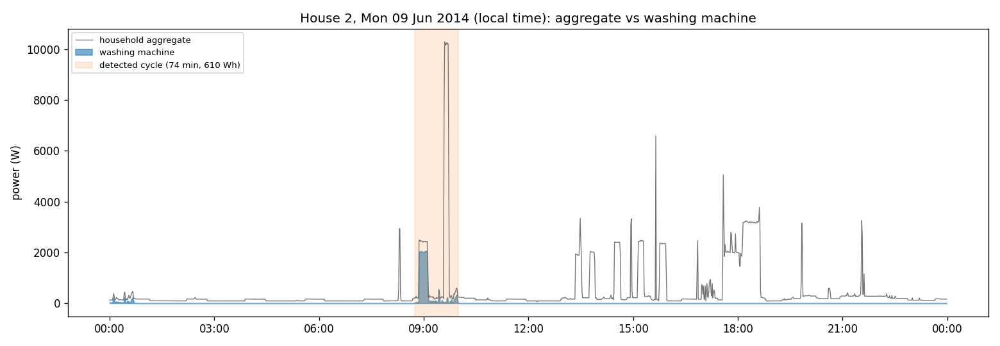

House 2, Monday 9 June 2014. The day was chosen automatically: a day with complete data, one wash,
and that wash's energy closest to the house median. The 74-minute, 610 Wh wash at 08:45 is clearly
visible in the aggregate only during its ~2 kW heating phase. While it runs, a separate ~10 kW
appliance (most likely an electric shower) dominates the whole-house signal, and the afternoon has
several other 2–3 kW loads that look just like the WM heater. This is why disaggregating the WM is
hard: its most visible feature is not unique.

### Plot (ii): detected cycles

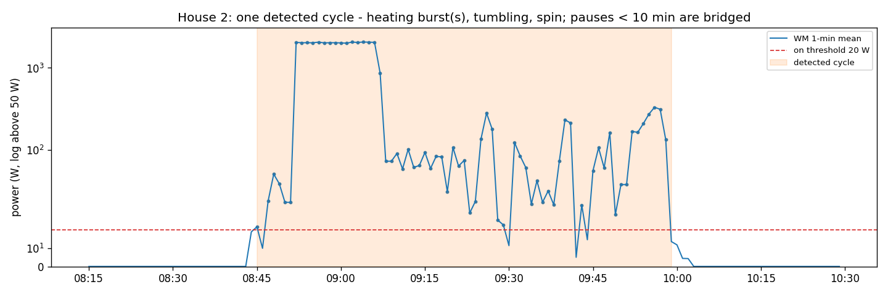

The same wash in detail: a short fill, about 15 minutes of heating at ~1.9 kW, then 50–300 W of
tumbling and spinning. Several brief dips below 20 W are bridged by the 10-minute merge rule. The
heating phase is where most of the energy goes.

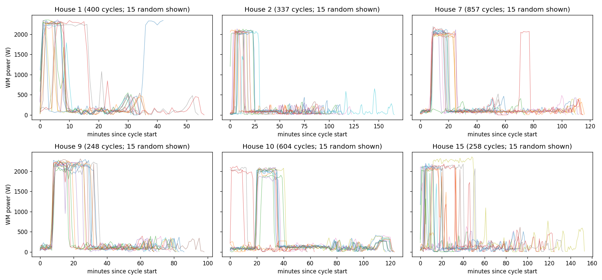

Fifteen random cycles per house, aligned at their start. Every house shows heater-then-tumble, but
the machine and programme mix differ: House 10 almost always runs the same ~120-minute programme
(heating at 20–35 minutes), House 1 runs short ~33-minute washes, and House 15 varies most.

### Usage patterns: hour of day and day of week

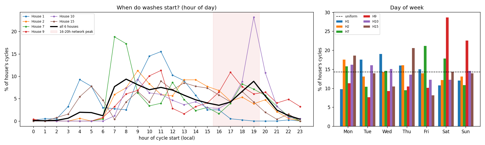
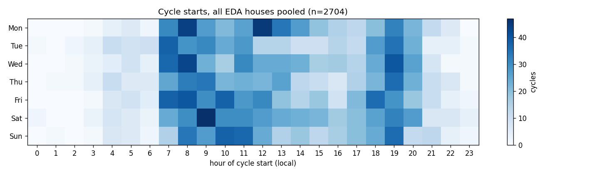

- **Pooled over the six houses** (`eda_wm_hourly_share_pct.csv`), 39.7 % of washes start
  between 07:00 and 11:59 and 21.1 % between 18:00 and 20:59 (19:00 alone is 8.9 %). Only 6.0 %
  start between midnight and 06:59.
- **Weekday evening peak:** 16.2 % of all washes start on a weekday between 16:00 and 19:59,
  ranging from **2.2 % (House 1) to 29.0 % (House 10)**; 23 % of House 10's washes start at
  19:00 alone.
- **Night-time timer use:** Houses 1 and 15 often start at 04:00–05:00, which looks like a
  delay-start timer on a night-rate tariff. House 1 never starts after 17:00.
- **Day of week:** 29.0 % of washes are at weekends overall (2/7 = 28.6 % if evenly spread), but
  House 9 does **51.2 %** of its washes at weekends, while the others spread them across the week.

### Plot (iii): cross-house comparison

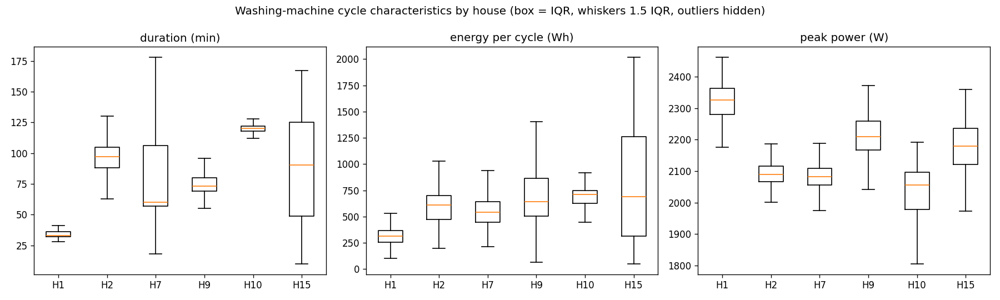

| House | Median duration | Median energy | Median peak | WM share of house energy |
|---|---|---|---|---|
| 1 | 33 min | 317 Wh | 2,326 W | 2.28 % |
| 2 | 97 min | 610 Wh | 2,090 W | 3.93 % |
| 7 | 60 min | 541 Wh | 2,083 W | 6.76 % |
| 9 | 73 min | 642 Wh | 2,210 W | 2.61 % |
| 10 | 120 min | 711 Wh | 2,056 W | 4.26 % |
| 15 | 91 min | 688 Wh | 2,180 W | 6.74 % |

**Peak power is almost the same everywhere** (2.05–2.33 kW: it is set by the heater element),
whereas **duration and energy per wash vary several-fold between homes** (median 317–711 Wh;
House 15's middle half spans about 300–1,250 Wh). For a model this means the peak height
transfers between houses but the cycle shape and length do not.

### Seasonality: how often, and how much energy per wash

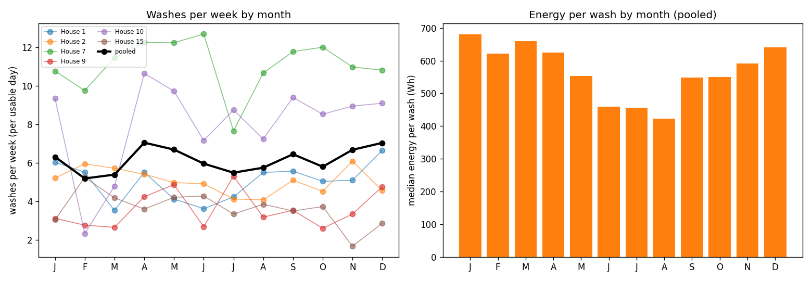

`eda_wm_seasonality.csv`. Washes per week are counted per **usable** day of each house-month
(house-months with fewer than 7 usable days are left out), so outages such as House 1's
February 2014 gap do not look like months without washing.

- **How often barely changes with the season:** pooled, 5.2–7.0 washes per house-week in every
  month, with no clear summer or winter pattern (the highest months are April, 7.04, and
  December, 7.03). Individual houses move more (House 10: 2.3 to 10.6) but in different months.
- **Energy per wash does change: about 60 % more in winter.** The median wash uses 680 Wh in
  January and 641 Wh in December, against 423 Wh in August. Median heating time (minutes above
  1 kW) goes from 16 minutes in January to 10 in July and August. The likely cause is colder mains
  water in winter, so the heater needs longer to reach the same temperature; seasonal programme
  choice (e.g. more hot washes in winter) could add to it.
- **Why it matters:** the UK network peak is highest in winter, which is exactly when each
  evening wash adds the most energy.

### Wash programmes

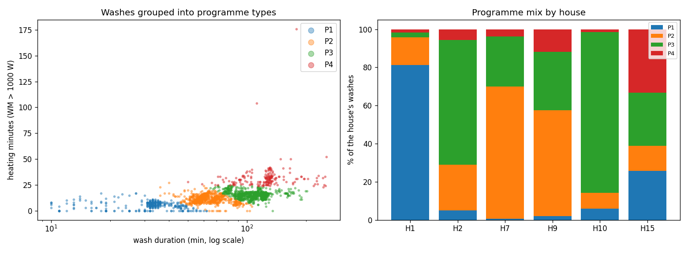

Washes were grouped into programme types with k-means on two standardised features: log wash
duration and **heating minutes** (minutes above 1 kW, a proxy for wash temperature). The number
of groups was chosen by silhouette score among 2–6 groups, requiring every group to hold at
least 2 % of washes (`eda_wm_programme_k.csv`): 5 groups scored marginally higher (0.511 vs
0.506) only by giving 2 unusual washes a group of their own, so **4 programme types** were kept.

| Programme | Washes | Share of washes | Share of energy | Median duration | Median heating | Median energy | Start on weekday 16:00–19:59 |
|---|---|---|---|---|---|---|---|
| P1 quick | 455 | 16.8 % | 7.3 % | 33 min | 6 min | 272 Wh | 4.4 % |
| P2 standard | 954 | 35.3 % | 29.2 % | 60 min | 12 min | 493 Wh | 15.0 % |
| P3 long | 1,112 | 41.1 % | 48.3 % | 116 min | 16 min | 705 Wh | 22.2 % |
| P4 hot | 183 | 6.8 % | 15.2 % | 128 min | 31 min | 1,283 Wh | 15.3 % |

(`eda_wm_programmes.csv`, `eda_wm_programmes_by_house.csv`, `eda_wm_cycles.csv`)

- **Each household has a habit.** House 1 runs the quick programme 81 % of the time, House 10
  the long one 84 %, House 7 the standard one 69 %. House 15 is the most varied and does a
  third of its washes hot (33 %).
- **A hot wash uses about 2.6 times the energy of a standard one** (1,283 vs 493 Wh), because the
  heater runs about 2.5 times longer. Hot washes are 7 % of washes but 15 % of wash energy.
- **Long washes are the most peak-heavy:** 22 % of P3 washes start on a weekday evening peak,
  against 4 % of quick washes. Most of these peak-time long washes (159 of 247) are House 10's
  19:00 habit.
- **Caveat:** the groups describe the shape of the electrical load, not the programme selected on
  the machine. Two different programmes with similar length and heating time fall in one group.

---

## Part 3: disaggregation model

**Task.** Estimate WM power (W) each minute from the household aggregate, using official cleaned
data at 1-minute resolution.

**Homes and periods** (`model_split.csv`):

| Role | Houses | Data used |
|---|---|---|
| Train | 2, 7, 10, 15 | first 80 % of each record, i.e. up to 2015-01-24 (H2), 2015-03-07 (H7), 2015-03-05 (H10), 2015-03-16 (H15) |
| Time-split test | 2, 7, 10, 15 | last 20 %, starting 1 day after each cut-off, to the end of the record (≈ 79–105 evaluated days per house) |
| Validation | 9 | full record 2013-12-17 → 2015-07-08 |
| Test (unseen houses) | 8, 17 | full records 2013-11-01 → 2015-05-11 and 2014-03-06 → 2015-06-19 |

**Data filters** (`model_excluded_minutes.csv`):
- **Stuck aggregate:** where the aggregate is exactly flat for an hour or more (a stuck,
  forward-filled sensor, DATA.md §5), it is set to missing, so those minutes are neither used as
  inputs nor scored. This removes 7.99 % of House 10's minutes, 4.73 % of House 9's,
  2.16 % of House 17's and 0.57–1.01 % elsewhere.
- **Other dropped minutes:** those with a missing aggregate or WM reading, or with WM > aggregate.

That leaves 2,286,286 training minutes, of which 146,129 (6.4 %) have the WM on (> 20 W).

### Approach

**Inputs (Seq2Point idea).** The target is the WM power at minute *t*; the inputs summarise the
aggregate in a window **t − 60 … t + 60 min**, both before and after *t*:
- changes relative to *t* at ±1, 2, 3, 5, 10, 15, 30, 60 min, and one-step differences;
- centred rolling mean, standard deviation, max, min, height above the window minimum, total
  absolute change and largest step, over 5, 15, 31, 61 and 121 minutes;
- the share of the window spent 1.5–2.6 kW above the window floor (the heater signature).

**Feature-set choice on validation** (`model_feature_set_selection.csv`):

| Feature set | Features | Validation RMSE | Validation on/off F1 (30 W) |
|---|---|---|---|
| all (incl. time of day, day of week) | 63 | 151.2 W | 0.373 |
| no time features | 59 | 150.6 W | 0.384 |
| **shape only (no time, no absolute power levels; chosen)** | 43 | **149.8 W** | **0.388** |

Always-off scores 166.7 W RMSE on validation. The chosen set describes only changes and shapes
relative to the window, so it does not depend on a house's base load or on the training houses'
daily routine; it was also best on validation.

**Model.** A LightGBM regressor (600 trees, learning rate 0.05, 63 leaves, seeded and
deterministic) predicts WM power directly. There is no early stopping: the validation error curve
is almost flat, so early stopping stops after ~15 trees, which at this learning rate only moves
predictions about halfway (1 − 0.95¹⁵ ≈ 54 %) from the mean towards the target.

- **On/off threshold:** predicted power below **50 W** is set to 0. The threshold was chosen on the
  validation house from 10–200 W by on/off F1 (`model_threshold_tuning.csv`; F1 0.30 at 10 W,
  0.40 at 50 W, 0.27 at 200 W).
- **Cycle post-processing:** predicted power is kept only where it forms a valid wash under the
  same rule as the ground truth (≥ 10 min, ≥ 50 Wh, pauses < 10 min merged).

**Post-processing decided on the validation house** (`model_final_choice.csv`), by on/off F1:

| Validation house 9 | On/off F1 | Cycle F1 | Energy error |
|---|---|---|---|
| regressor + threshold | 0.399 | 0.408 | +46.2 % |
| **regressor + threshold + cycle post-processing (final)** | **0.468** | **0.408** | **+32.4 %** |

Cycle F1 cannot separate the two, because the per-cycle metric already applies the cycle rule to
predictions.

### Baselines

- **Always off:** predicts 0 W. It is the honest floor for a mostly-off appliance and has a very low
  MAE.
- **Hour-of-day profile:** mean WM power by hour × weekday/weekend, learned from the training
  minutes. It is what you could do without any disaggregation.

### Metrics, and why

| Metric | Why it matters |
|---|---|
| **MAE (W)** per minute | standard, but dominated by the ~95 % of minutes when the WM is off, so always-off scores well |
| **Total energy error (%)** | what a utility report or bill-breakdown would show |
| **Daily energy MAE (Wh/day)** | is the per-day estimate usable for customer feedback? |
| **On/off precision / recall / F1** (truth on > 20 W, prediction on > threshold) | does the model know *when* the WM runs? |
| **Per-cycle precision / recall / F1** | event level: a true cycle is detected if any predicted cycle (same cycle rule) overlaps it; a predicted cycle is correct if it overlaps a true one. Closest to "how many washes did we spot". |

Pooled rows over several houses are computed from the houses' summed counts (true positives,
predicted and true on-minutes, detected washes, absolute errors), so pooled precision, recall and
F1 are consistent with each other and each house weighs in proportion to its data.

### Results (`model_metrics.csv`; "LightGBM" = final model `lgbm_cycles`)

**Unseen test houses 8 and 17** (924 evaluated days):

| Model | House | MAE | Energy error | Daily energy MAE | On/off P / R / F1 | Cycles true / predicted | Cycle P / R / F1 |
|---|---|---|---|---|---|---|---|
| always off | 8 | 29.31 W | −100 % | 677.2 Wh | 0 / 0 / 0 | 369 / 0 | – |
| hour profile | 8 | 54.38 W | **−9.3 %** | 616.5 Wh | 0.03 / 0.37 / 0.05 | 369 / 1358 | 0.10 / 0.40 / 0.16 |
| **LightGBM** | 8 | 31.57 W | −20.1 % | **403.8 Wh** | 0.48 / 0.75 / **0.58** | 369 / 1164 | 0.31 / 0.96 / **0.47** |
| always off | 17 | 10.05 W | −100 % | 232.5 Wh | 0 / 0 / 0 | 288 / 0 | – |
| hour profile | 17 | 34.72 W | +164.8 % | 445.2 Wh | 0.04 / 0.69 / 0.07 | 288 / 1229 | 0.16 / 0.73 / 0.26 |
| **LightGBM** | 17 | **8.66 W** | **−14.7 %** | **123.4 Wh** | 0.59 / 0.59 / **0.59** | 288 / 453 | 0.53 / 0.83 / **0.65** |
| always off | pooled | **20.32 W** | −100 % | 469.9 Wh | 0 | 657 / 0 | – |
| hour profile | pooled | 45.21 W | +30.9 % | 536.7 Wh | 0.06 | 657 / 2587 | 0.21 |
| LightGBM without post-processing | pooled | 22.75 W | **−8.5 %** | 275.1 Wh | 0.38 / 0.73 / 0.50 | 657 / 1617 | 0.53 |
| **LightGBM (final)** | pooled | 20.89 W | −18.9 % | **273.1 Wh** | 0.51 / 0.69 / **0.586** | 657 / 1617 | 0.37 / 0.90 / **0.53** |

**Within-house time split** (training houses, last 20 % of their records, 364.3 days):

| Model | MAE | Energy error | Daily energy MAE | On/off F1 | Cycle P / R / F1 |
|---|---|---|---|---|---|
| always off | 28.72 W | −100 % | 626.2 Wh | 0 | – |
| hour profile | 50.12 W | **−7.8 %** | 509.8 Wh | 0.17 | 0.27 / 0.75 / 0.40 |
| **LightGBM (final)** | **18.68 W** | −13.7 % | **202.6 Wh** | **0.64** | 0.56 / 0.94 / **0.70** |

Per house, on/off F1 is 0.34 (H2), 0.80 (H7), 0.57 (H10) and 0.83 (H15).

**Validation house 9:** LightGBM MAE 22.92 W (always-off 15.84 W), energy +32.4 %, on/off
F1 0.47, cycle F1 0.41 (1,036 predicted vs 256 true washes).

**Interpretation.**

- **It finds almost every wash, but reports far too many.** In unseen houses it detects 90 % of
  real washes (cycle recall 0.90), but only 37 % of the washes it reports are real: 1,617 predicted
  vs 657 true, about 2.5 per real wash. On/off F1 is 0.59 and cycle F1 0.53. Both baselines are far
  behind on timing (on/off F1 ≤ 0.06, cycle F1 ≤ 0.21).
- **Per-minute MAE does not beat always-off on new houses** (20.89 vs 20.32 W pooled; worse in
  House 8, better in House 17), and is clearly worse on validation (22.92 vs 15.84 W). It does beat
  always-off on future months of the training houses (18.68 vs 28.72 W).
- **Total energy is closer than the minute-level errors suggest, partly by cancellation:**
  −18.9 % pooled (House 8 −20.1 %, House 17 −14.7 %; future months −13.7 %), but +32.4 % on
  validation, so even the sign changes between houses.
  - When a real wash is detected, the predicted heater reaches only about half of its true ~2.2 kW
    (actual-vs-predicted plot below), so energy inside real washes is too low.
  - False washes add energy that the house did not use.
  - The two errors roughly offset in the test houses but not in the validation house, where false
    washes dominate. The total-energy number is therefore not a reliable sign of a good model.
- **Why a single regressor behaves like this:** about 94 % of training minutes are "off", so
  minimising squared error teaches the model to hedge: predict a moderate value whenever the
  aggregate looks a bit like a wash, and never commit to the full 2 kW. A separate on/off classifier
  plus a power model trained only on "on" minutes is the first improvement to try (README).
- **On total energy the hour-of-day profile scores better** in House 8 and on future months
  (−9.3 % and −7.8 %), but it has no idea *when* washes happen (on/off F1 0.05–0.17) and is
  off by +164.8 % in House 17.
- **Future months of known houses are easier than new houses** (on/off F1 0.64 vs 0.59; cycle
  F1 0.70 vs 0.53).

### Actual vs predicted on evaluation data

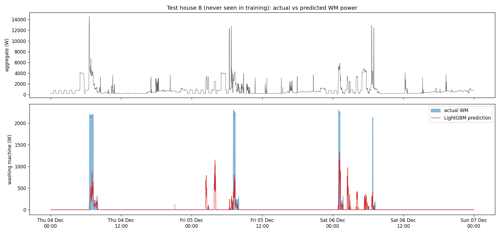

Test house 8, 4–6 December 2014 (window chosen automatically: starts on the day whose WM energy
is closest to the 75th percentile of days with use).
- **Detected:** all four washes are flagged at least partly, but the predicted heater peaks at
  about 0.4–1.3 kW against 2.1–2.3 kW actual.
- **False alarms:** several bursts of 0.3–1.2 kW at night and in the early morning of 5 and 6
  December, when the WM is off.

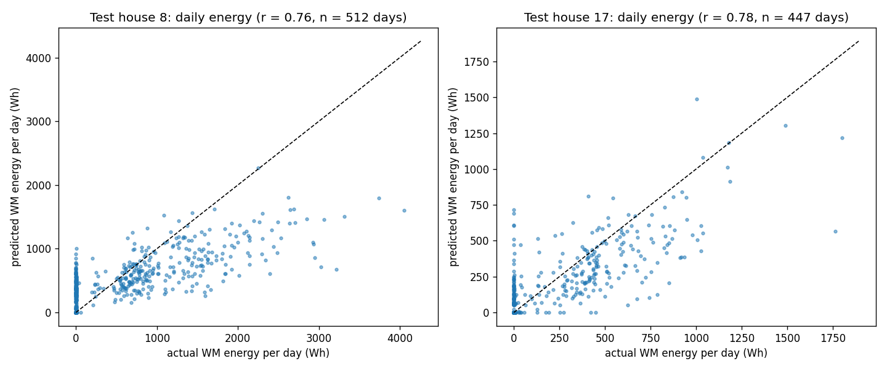

Daily WM energy on the test houses: correlation 0.76 (House 8, 512 days) and 0.78 (House 17,
447 days). Many days with no washing get a prediction of up to ~1 kWh (false washes, the column at
x = 0), while high-use days are under-predicted (points below the diagonal).

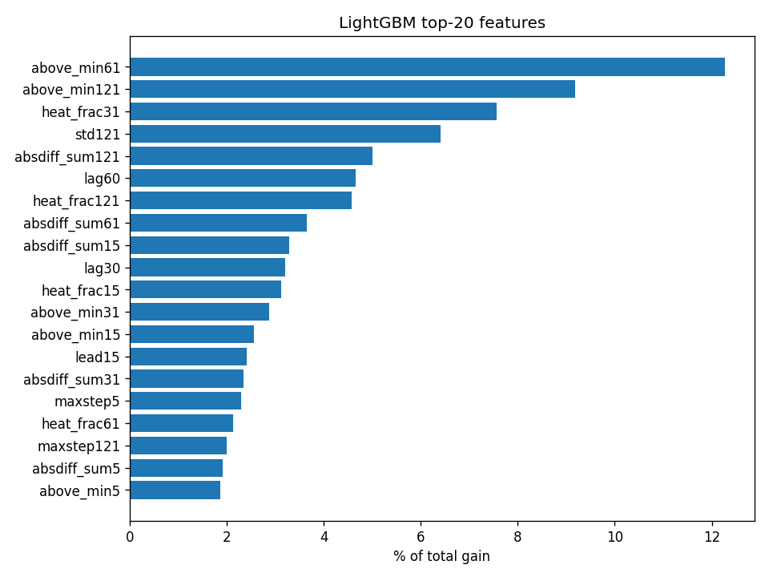

The most important inputs are the **height of the aggregate above its window minimum** over 61 and
121 minutes (12.3 % and 9.2 % of total gain), the **share of time in the heater band**
(`heat_frac31`, 7.6 %) and the window's variability. The model mainly looks for "something about
2 kW above the base load", which any similar heating load also provides; this explains the false
alarms below.

### Failure cases (`model_failure_cases.csv`)

**1. A long flat heating load looks like a wash (false positive).** House 8, 3 January 2014,
01:43–03:08: a load of about 3 kW that stays flat for about an hour (most likely a storage or
immersion heater) is read as a 732 Wh wash; true WM use is 0 Wh. It sits about 2–3 kW above the
base load, which is exactly what the top features measure. Nothing in the inputs captures that a
WM heater lasts only 10–25 minutes and is surrounded by drum flicker.

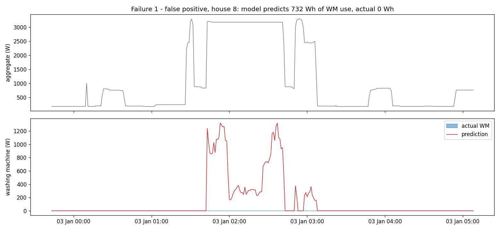

**2. A wash hidden under a busy morning (missed).** House 8, 7 May 2014, 06:28–07:35: a 1,114 Wh
wash with two heating phases runs while the aggregate shows 12–17 kW shower spikes and 3–8 kW of
other loads. Both the heater step and the drum flicker are buried, and the model predicts none of
it.

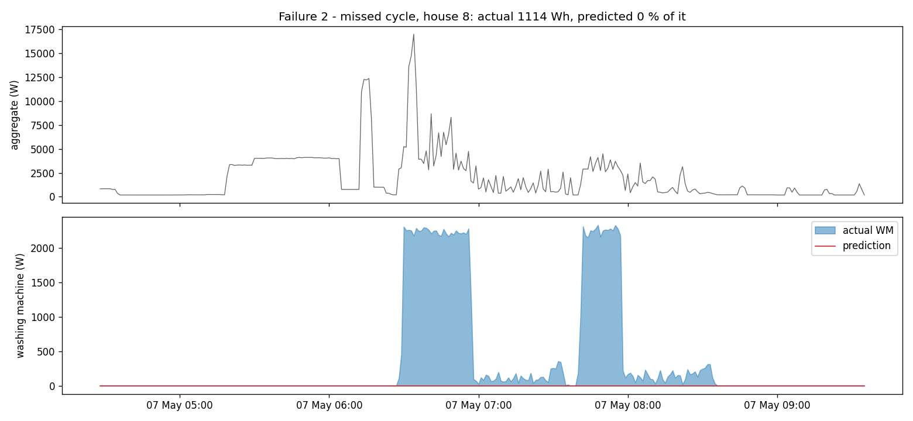

**Other situations where the model will struggle:**

- **Washes without a heating phase** (cold or 20 °C programmes, or machines that take hot water
  from the boiler): the main cue is missing.
- **Washer-dryers:** the drying phase looks like a long heater load.
- **Homes with storage heaters, immersion heaters or electric cooking at night:** many false washes.
- **Stuck or forward-filled aggregate data:** flat runs of 60+ minutes are filtered, shorter ones
  are not.
